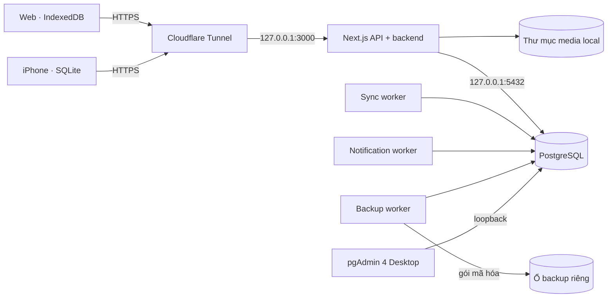

# Vận hành LumaPOS tự host

Tài liệu này mô tả runtime PostgreSQL + Next.js đã chọn, cấu hình dự kiến trên
Mac tại cửa hàng, đường chuyển lên VPS và các cổng kiểm soát trước cutover.
Đây là runbook triển khai, không phải kiểm tra trạng thái realtime. Trạng thái
đã quan sát được ghi kèm ngày kiểm tra bên dưới; trước mỗi thao tác vận hành,
xác minh lại database và runtime đang dùng.

## Kiến trúc chạy



- PostgreSQL giữ hồ sơ kinh doanh đã được chấp nhận. Next.js là API duy nhất cho
  trình duyệt và iPhone. Client không chứa thông tin đăng nhập PostgreSQL.
- Web tiếp tục lưu offline trong IndexedDB; iPhone tiếp tục lưu trong SQLite.
  Client lưu thay đổi trước khi gửi và giữ trạng thái chờ cho đến khi nhận biên
  nhận từ backend. Các command đã đưa vào sync inbox có idempotency theo
  `(store_id, event_id)` và hash payload; worker xử lý bằng khóa hàng và trả
  `accepted`, `rejected` hoặc `conflict`. Khi import relay cũ, trạng thái
  `processing` được trả về `pending`; biên nhận kết thúc được giữ nguyên.
- Backend chạy lại quy tắc nghiệp vụ trong transaction. Tồn kho, giá và tài
  chính không giải quyết bằng last-write-wins. Catalog offline là snapshot để
  tra cứu; nó không cấp quyền ghi đè giá hay tồn kho đã được server xác nhận.
- Mỗi loại command phải được chuyển và kiểm chứng riêng. Có dữ liệu offline ở
  client không đồng nghĩa mọi màn hình hiện đã hỗ trợ ghi offline.
- Khi trình duyệt nâng cấp từ outbox cũ chưa có tenant scope, app giữ bản ghi
  trong IndexedDB riêng và không tự phát lại dưới cửa hàng/tài khoản đang đăng
  nhập. Owner hoặc manager có thể tải bản sao để xác minh và xử lý thủ công;
  file xuất có thể chứa dữ liệu khách hàng/tài chính. Outbox đã được scope ở
  phiên bản hiện tại được giữ nguyên khi nâng cấp schema IndexedDB tiếp theo.
  Bản nâng cấp này không thể phục hồi hàng đợi đã bị xóa nếu thiết bị đã từng
  mở bản v3; kiểm tra các thiết bị từng có đơn offline chờ trước khi dựa vào
  bản sao trong kho cách ly.

## Mac tại cửa hàng

### PostgreSQL và pgAdmin

1. Dùng PostgreSQL 17 trên Mac, database `lumapos_local`, lắng nghe
   `127.0.0.1:5432`/localhost. Các script hiện có là
   [`scripts/setup-local-postgres-macos.sh`](../scripts/setup-local-postgres-macos.sh)
   và [`scripts/migrate-local-postgres-macos.sh`](../scripts/migrate-local-postgres-macos.sh).
2. Trong pgAdmin 4 Desktop, đăng ký server local. Profile Mac hiện dùng host
   `/tmp` (Unix socket), port `5432`, maintenance database `postgres` và tài khoản
   DBA local; tùy chọn lưu mật khẩu đang tắt. pgAdmin không chạy trong Next.js
   và không được xuất bản qua tunnel.
3. Tạo role đăng nhập `lumapos_runtime` trong pgAdmin: bật Login, Bypass RLS;
   tắt Superuser, Create roles, Create databases và Replication. Đặt mật khẩu
   mạnh riêng cho role này. Chọn target database rồi chạy
   [`scripts/grant-self-hosted-runtime-role.sql`](../scripts/grant-self-hosted-runtime-role.sql)
   bằng đúng DBA/migration owner. Script cấp quyền CRUD, sequence và function
   trong `public`, đồng thời đặt default privileges cho schema tương lai; role
   runtime không có quyền CREATE và không sở hữu database, schema hay object
   nghiệp vụ.
4. Đặt URL của `lumapos_runtime` trong `DATABASE_URL` của Next.js/workers. Giữ
   role DBA riêng cho pgAdmin và `MIGRATION_DATABASE_URL`; không dùng superuser
   làm kết nối thường trực của ứng dụng. Sau mỗi data import, chạy grant script
   trên target bằng migration owner để cấp quyền cho objects vừa được nhập.
   `db:restore` tự áp dụng lại các grant và default privileges sau khi phục hồi.
5. Chỉ DBA được xem/sửa bảng tùy ý hoặc chạy SQL trong pgAdmin. Người dùng POS
   quản lý tài khoản, vai trò, worker và backup trong các trang LumaPOS được
   phân quyền. Các script bootstrap vẫn dùng tài khoản PostgreSQL của macOS để
   tạo schema ban đầu; sau đó app runtime chuyển sang login role riêng.

**Trạng thái đã kiểm tra ngày 2026-11-13:** PostgreSQL 17.11 đang chấp nhận kết
nối tại `127.0.0.1:5432`. `lumapos_local` có 177 migration tới
`0165_cleanup_storage_provider.sql`, 3 cửa hàng, 3 hồ sơ, 3.292 sản phẩm, 3.157
đơn và 469 media object. Đối soát chỉ đọc với database đang cấu hình cho thấy
cùng 177 migration nhưng lệch số dòng ở 9 bảng; tổng số lượng `stock_movements`
cũng lệch 1,0 đơn vị. Snapshot này chưa được xác nhận là nguồn chính. Các số liệu là
ảnh chụp của lần kiểm tra, không khẳng định trạng thái ở thời điểm sau đó.

Trong cùng đợt, `lumapos_rehearsal` được tạo riêng, nhập từ database đang cấu
hình. Đối soát chỉ đọc chạy lại ngày 2026-11-13 trả `reconciled`: 140 bảng so
sánh được, không thiếu bảng/cột và không có lệch row count, row checksum hay
tổng hợp tài chính. Cả 177 migration nguồn đều có ở rehearsal; rehearsal có
thêm `0166_media_migration_library_assets.sql`. Hai bên có cùng 469 media object
R2. Ba hồ sơ có ba Auth credentials khớp, không có tài khoản cần reset; hai
`email_verified_at` chỉ khác ở microsecond dưới độ chính xác millisecond. Trạng
thái sync receipt hai bên đều rỗng và khớp. Đây vẫn là rehearsal, chưa được tuyên
bố làm nguồn dữ liệu chính.

Ngày 2026-11-14, một snapshot rehearsal mới được nhập riêng vào
`lumapos_rehearsal_20261114_a`; không sửa `lumapos_local` hay ghi vào Supabase.
Target có 178 migration, trong khi nguồn có 177; migration bổ sung duy nhất là
`0166_media_migration_library_assets.sql`. Đối soát chỉ đọc trên 140 bảng không
thấy bảng/cột thiếu, lệch row count, checksum dữ liệu hay tổng hợp tài chính.
Snapshot có 3 cửa hàng, 3 hồ sơ, 3 Auth credentials, 3.293 sản phẩm, 3.158 đơn,
không có sync receipt và không có tài khoản cần reset. Hai timestamp
`email_verified_at` lệch dưới một millisecond; các trường Auth còn lại khớp.
Đây vẫn là snapshot rehearsal trong lúc nguồn tiếp tục hoạt động, chưa phải
snapshot cuối hoặc nguồn dữ liệu chính.

Đối soát chỉ đọc lại `_20261114_a` sau đó phát hiện nguồn đã tiến thêm ở
`catalog_delta_events` (nguồn 11.281 dòng, rehearsal 12.189 dòng), đồng thời
checksum của `catalog_sync_state` và `media_objects` khác nhau; tổng hợp tài
chính và Auth vẫn khớp. Không sửa database rehearsal cũ. Ngày 2026-11-14, tạo
database rỗng riêng `lumapos_rehearsal_20261114_b`, chạy đủ 178 migration rồi
nhập snapshot mới; nguồn Supabase và `lumapos_local` không bị ghi. Đối soát lại
trên 140 bảng trả `reconciled`: không thiếu bảng/cột, không lệch dòng, checksum
hay tổng hợp tài chính; 3 Auth credentials khớp và không có tài khoản cần reset.
Hai `email_verified_at` vẫn chỉ lệch dưới một millisecond. Cả hai phía có 469
media object provider `r2`; sync receipt rỗng và khớp. Đây là rehearsal mới nhất
đã xác minh, không thay thế final snapshot sau khi cửa hàng dừng ghi.

Trên database `_20261114_b`, media run
`2acca2a0-168d-4b9e-918a-5b8c30be8724` đã copy và đọc lại SHA-256 của đủ 454
managed media tại `/Users/Shared/LumaPOS/media`, không có mục quarantine. Run
giữ 1.349 item `skipped`, tương ứng 2.022 external URL; không tải hoặc viết lại
các URL đó. `media_objects` vẫn có 469 provider `r2`, tức provider chưa đổi và
R2 source chưa bị xóa. Chỉ chuyển provider sau khi HTTP media route, backup/
restore trên volume riêng và HTTPS đều qua rehearsal.

Preview media trên rehearsal phát hiện 2.476 tham chiếu: 454 owned theo host và
bucket allowlist hiện tại, 2.022 `external_url` ngoài allowlist Supabase hiện tại;
cần rà soát domain trước cutover, không tải hoặc viết lại nhóm này. Trong 469
`media_objects` R2 có 454 `ready`, 15 `deleted`. Probe R2 hiện trả `ready: false`;
đây là preflight kiểm tra R2 làm đích ghi, không xác nhận quyền đọc object R2
nguồn. Ngày 2026-11-13, probe nguồn xác nhận đọc được object mẫu public/private.
Clone `lumapos_runtime_rehearsal_20261113_a` đã chép và SHA-256 verify đủ 454
object R2 vào `/Users/Shared/LumaPOS/media`; 2.022 URL ngoài allowlist vẫn được
bỏ qua. Database clone chính vẫn giữ provider `r2` và chưa cutover. Một clone
riêng dùng cho backup rehearsal đã cutover media local. Các bước này không đổi
Supabase Cloud, không xóa object R2 và không xác nhận snapshot cuối là nguồn
chính. Các số liệu là ảnh chụp ngày 2026-11-13.

Với snapshot ngày 2026-11-14, media run
`a7d538f1-254c-4500-8da2-995ddb52d9a7` đã copy và verify SHA-256 đủ 454 object
managed vào thư mục media local. Inventory ghi nhận 1.349 mục `skipped`; 2.022
URL ngoài allowlist vẫn không bị tải hoặc viết lại. Thử cutover chỉ trong
database rehearsal rồi rollback ngay sau khi backend gate chặn API vì snapshot
chưa được tuyên bố authoritative. Candidate hiện giữ provider R2 cho 469 rows;
454 object đã verify vẫn còn local, 15 object deleted không được tải. Không xóa
source R2.

### Next.js và workers

**Trạng thái ngày 2026-11-14:** bản production đã build trong
`/Users/Shared/LumaPOS/app`, nhưng Next.js và tunnel connector hiện đã dừng.
`LUMAPOS_PRIMARY_DATABASE_CONFIRMED` vẫn `false`; app chưa nhận traffic nghiệp
vụ. Kiểm tra loopback ngày 2026-11-14 cho thấy `/api/health/live` trả 200 và
`/api/health/ready` trả 503 `not_ready` khi gate này còn khóa. pgAdmin 4 đã cài
và profile `LumaPOS Mac - DBA` đã kết nối qua Unix socket local; profile không
lưu mật khẩu và không được publish qua Tunnel. Credential role runtime được
luân chuyển ngày 2026-11-14; giá trị chỉ nằm trong tệp cấu hình bảo vệ mode 600.
Trên `lumapos_rehearsal_20261114_b`, script grant cấp quyền DML cho
`lumapos_runtime`; kiểm tra xác nhận role không có quyền tạo database/schema và
không sở hữu database/schema/object. Bản production được chạy tạm trên loopback
cổng 3001 với Auth LumaPOS, media provider local, `DATABASE_URL` nhắm `_b` và
primary gate vẫn `false`: `/api/health/live` trả 200, `/api/health/ready` trả
503 `not_ready`. Tiến trình đã dừng, cổng 3001 đã đóng và Tunnel chưa được chạy.
Tài khoản dịch vụ ẩn `_lumapos_svc` đã được tạo, không thuộc nhóm admin và dùng
shell `/usr/bin/false`. `/Users/Shared/LumaPOS` có group `staff`, mode `0710` để
service account đi tới đường dẫn đã biết; `secrets`, `logs` và `media` thuộc
service account. `runtime.env`, `cloudflared.yml` và tunnel credential thuộc
`_lumapos_svc`, mode `0600`. Bun 1.3.12 đã được đặt ở
`/Users/Shared/LumaPOS/bin/bun`; các plist mẫu dùng service account này. Chưa
cài hoặc nạp LaunchDaemon cho backend/worker; Next.js và Tunnel vẫn dừng.
PostgreSQL tiếp tục chạy dưới LaunchAgent của phiên người dùng; không chuyển
PostgreSQL sang user khác khi chưa có cửa sổ bảo trì. Chủ sản phẩm chọn backup
trên ổ cứng ngoài thay cho R2; lần kiểm tra ngày 2026-11-14 chưa thấy volume
ngoài đang mount, nên đường dẫn runtime và worker backup chưa được cấu hình.
Cửa sổ bảo trì 60 phút chưa lên lịch; cutover được để lại cho lần chốt sau.
`cloudflared` đã có tại `/opt/homebrew/bin/cloudflared`; connector vẫn dừng.
Release app thuộc tài khoản tương tác và đọc được qua group `staff`.

Chạy ứng dụng tự host trên loopback bằng `bun run start:self-hosted`. Dùng
LaunchDaemon với service account để tự khởi động cùng máy và phục hồi khi tiến
trình lỗi; không phụ thuộc vào cửa sổ Terminal hay phiên đăng nhập của nhân viên.
Ví dụ plist, wrapper và quy trình cài đặt nằm trong
[`ops/macos`](../ops/macos/README.md). PostgreSQL được Homebrew quản lý.

Các tiến trình dài hạn:

```bash
bun run sync:postgres:worker
bun run notifications:postgres:worker
bun run db:backup:worker -- --scheduled
```

Worker sync nhận command qua PostgreSQL inbox. Worker notification lấy việc từ
`notification_outbox`; không cần QStash. Backup worker tạo một bản mỗi ngày và
tiếp tục chờ việc backup thủ công trong hàng đợi.

Các tác vụ định kỳ gọi vào origin loopback, không đi qua Internet:

```bash
bun run ops:maintenance -- --task=notifications
bun run ops:maintenance -- --task=media-cleanup
bun run ops:maintenance -- --task=einvoices
```

Mỗi lệnh yêu cầu `CRON_SECRET`; chỉ local supervisor được gọi. Trước khi cấu
hình lịch Mac, phân biệt lịch hiện có với endpoint chưa được lịch hóa:

| Công việc | Hiện trạng theo `vercel.json` | Hành động trên Mac |
| --- | --- | --- |
| `/api/cron/notifications/outbox` | Mỗi ngày lúc 00:00 UTC (07:00 giờ Việt Nam). Worker PostgreSQL mới đã tự poll và phục hồi outbox liên tục. | Không tạo cron lặp lại cho route này sau cutover. |
| `/api/cron/media/cleanup` | Mỗi ngày lúc 02:15 UTC (09:15 giờ Việt Nam). | Giữ lịch này trong lần chuyển đầu để bảo toàn hành vi; chỉ đổi sang sau giờ đóng cửa khi chủ cửa hàng duyệt. |
| `/api/cron/notifications` | Không có trong `vercel.json`; route chạy thông báo nghiệp vụ định kỳ và bảo trì. | Chưa tự tạo lịch mới. Xác nhận lịch đang dùng và múi giờ trước khi chuyển. |
| `/api/cron/einvoices` | Không có trong `vercel.json`. | Chỉ bật sau khi chốt tần suất và hoàn tất rehearsal nghiệp vụ. |

Không để cron legacy của Vercel chạy song song sau cutover. Lịch Mac phải dùng
`launchd` và gọi `ops:maintenance` trên loopback; không mở endpoint cron ra
Internet. Giữ lịch cụ thể trong cấu hình deployment theo giờ địa phương của
cửa hàng, không suy diễn lịch mới từ tên endpoint.

Health check:

- `/api/health/live` xác nhận tiến trình Next.js.
- `/api/health/ready` kiểm tra PostgreSQL, quyền runtime role và heartbeat mới
  hơn 45 giây của sync, notification, backup worker. Khi Auth provider là
  `lumapos`, route trả 503 với blocker nguồn dữ liệu cụ thể nếu database chưa
  được xác nhận là primary. Sau đó route trả 503 nếu role còn
  quyền superuser/DDL/replication, sở hữu database/schema/object, thiếu
  `BYPASSRLS`, worker bắt buộc, ổ backup riêng đang mount/ghi được và có bản
  backup trong 26 giờ hoặc cổng media cutover chưa sẵn sàng. Backup worker có
  gate riêng xác nhận đúng snapshot
  nguồn để có thể tạo và xác minh bản backup cuối trước khi bật primary. Với
  media local, route còn kiểm tra cấu hình hợp lệ và
  thư mục root tồn tại, là thư mục, có quyền đọc/ghi/truy cập cho service
  account; kiểm tra này chỉ dùng `stat`/`access`, không tạo file. Ở runtime
  legacy, chỉ yêu cầu PostgreSQL. Với media local, route chặn khi còn managed
  object chưa chuyển local, attachment legacy, tác vụ xóa file ở provider cũ,
  attachment AI chưa gắn media ID hoặc migration chưa hoàn tất. URL ngoài chưa
  được rà quyền mặc định chặn readiness. Có thể cấu hình chính sách
  `preserve_until_review` để giữ URL tạm thời; khi bật, readiness chỉ tiếp tục
  nếu các điều kiện khác đạt và trang quản trị hiện cảnh báo thiết bị cần
  Internet cùng domain nguồn còn hoạt động. Chính sách này không xác nhận
  quyền sử dụng hay cho phép tải/allowlist URL.
- Trang `/admin` hiển thị quản lý tài khoản cùng trạng thái backend, workers,
  hàng đợi sync, backup, provider lưu file và các blocker media cutover cho owner.

### File, URL và quyền truy cập

- Trên Mac, đặt `MEDIA_WRITE_PROVIDER=local` và `MEDIA_LOCAL_ROOT` ở một thư
  mục dữ liệu riêng, ví dụ `/Users/Shared/LumaPOS/media`; không đặt trong repo.
- Database chỉ lưu provider, bucket, object key, metadata và checksum ổn định;
  không lưu đường dẫn tuyệt đối của Mac. URL công khai được tạo từ
  `LUMAPOS_PUBLIC_URL` và route media của backend. Media private dùng URL ký có
  thời hạn, được backend kiểm tra quyền; không để lộ đường dẫn filesystem.
- Khi chuyển lên VPS, giữ nguyên key và schema; chuyển thư mục media sang volume
  bền vững, đổi `MEDIA_LOCAL_ROOT`/`DATABASE_URL` và giữ nguyên hostname công
  khai nếu có thể. Không dùng ổ tạm hoặc filesystem container để lưu media.
- `media:migrate` inventory cả media object đã quản lý trên R2/Supabase Storage
  lẫn tham chiếu legacy. Dùng `--local-database --target-provider=local` để chỉ
  ghi vào DB local đã chọn qua `LUMAPOS_LOCAL_DATABASE_NAME`; script từ chối chạy
  local target với `DATABASE_URL` cấu hình. Managed object giữ nguyên ID và link,
  đồng thời chép/kiểm tra cả thumbnail. Xem
  [`media-r2-migration-runbook.md`](media-r2-migration-runbook.md) để chạy một
  migration riêng cho mỗi store. Chỉ xóa nguồn sau cửa sổ giữ lại đã duyệt.
  Các media ngoài allowlist phải được rà soát; không tải hoặc xóa chúng như
  media của cửa hàng.
- Backup local media cùng database vào volume ngoài qua `LUMAPOS_BACKUP_ROOT`;
  worker từ chối ghi nếu volume chưa mount hoặc cùng filesystem với app/media.
  Một ổ gắn tại cửa hàng chưa phải bản offsite; cần quyết định sau liệu có tạo
  thêm bản mã hóa ở nơi khác hay chấp nhận rủi ro mất đồng thời Mac và ổ.

## iPhone ngoài mạng cửa hàng: Cloudflare Tunnel

Cloudflare Tunnel đã được chọn và tạo với tên `lumapos-store-mac`. Hostname đã
chốt là `pos.haidangshop.com`; DNS route trong zone `haidangshop.com` trỏ riêng
hostname này tới tunnel, ingress chỉ tới `http://127.0.0.1:3000`, catch-all trả
404. Root domain và `www` vẫn ở Vercel; `media.haidangshop.com` vẫn là custom
domain của R2. Tại lần kiểm tra 2026-11-13, DNS đã cấu hình nhưng connector và
Next.js chưa chạy nên chưa có backend phục vụ hostname. Workspace iOS (fallback
trong `AuthAPIClient` và cấu hình Debug/Release) hiện dùng API origin
`https://pos.haidangshop.com`; build đã cài trên iPhone 17 Simulator ngày
2026-11-14 nhưng chưa phát hành cho người dùng. Mẫu không chứa tunnel credential ở
[`ops/cloudflared/config.yml.example`](../ops/cloudflared/config.yml.example).

- Tunnel tạo kết nối outbound; router không mở cổng inbound tới Mac. Chỉ route
  hostname ứng dụng tới Next.js. Catch-all phải trả 404.
- Không publish PostgreSQL, pgAdmin, SSH, hay thư mục media trực tiếp qua tunnel.
  Không đặt Cloudflare Access trước toàn bộ API; xác thực tài khoản LumaPOS và
  xác minh chữ ký webhook được thực hiện tại backend.
- Cấu hình `LUMAPOS_PUBLIC_URL` bằng origin HTTPS công khai này. iOS lấy API
  origin từ build setting `LUMA_API_BASE_URL` trong
  [`Info.plist`](../../luma-pos-mobile/native-ios/LumaPOSNative/Info.plist); mã
  nguồn và cấu hình Xcode Debug/Release đều mặc định trỏ tới hostname này.
  Build hiện tại chỉ mới cài trên Simulator; chỉ phát hành cho người dùng sau
  khi backend, tunnel và khôi phục đã được diễn tập.
- Khi chuyển lên VPS, đưa tunnel connector sang VPS hoặc cập nhật origin phía
  tunnel; giữ hostname để web và iPhone không phải đổi endpoint. Nếu WAN hoặc
  tunnel mất kết nối, thiết bị giữ việc ở local và gửi lại khi có mạng. Truy cập
  LAN khi WAN hỏng là một lựa chọn HA riêng, chưa nằm trong phiên bản đầu.

## Biến môi trường và secrets

`.env.example` giữ cấu hình legacy làm mặc định để không vô tình chuyển runtime
đang phục vụ. Chỉ cấu hình các giá trị target trong môi trường self-hosted sau
khi final snapshot được xác nhận:

| Biến | Mac | Chuyển lên VPS |
| --- | --- | --- |
| `DATABASE_URL` | PostgreSQL loopback, role `lumapos_runtime` | Endpoint PostgreSQL private trên VPS, cùng role quyền hạn giới hạn |
| `MIGRATION_DATABASE_URL` | Chỉ truyền cho tiến trình migration/restore; kết nối trực tiếp bằng DBA/migration owner | Chỉ truyền cho tiến trình migration/restore qua secret operator riêng |
| `LUMAPOS_AUTH_PROVIDER` | `lumapos` | Giữ nguyên |
| `LUMAPOS_PRIMARY_DATABASE_CONFIRMED` | `true` sau đối soát | Giữ nguyên |
| `LUMAPOS_BACKUP_SOURCE_CONFIRMED` | `true` riêng sau khi `DATABASE_URL` trỏ đúng snapshot cần backup | Giữ nguyên |
| `LUMAPOS_SYNC_INBOX_ENABLED` | `true` sau rehearsal sync POS | Giữ nguyên |
| `LUMAPOS_SERVICE_FIELD_SYNC_ENABLED` | `true` chỉ khi slice service đã đạt gate | Giữ nguyên |
| `NOTIFICATION_QUEUE_PROVIDER` | `database` | Giữ nguyên |
| `MEDIA_WRITE_PROVIDER` | `local` | Giữ `local` hoặc chuyển adapter sau khi đã copy file |
| `LUMAPOS_EXTERNAL_MEDIA_POLICY` | Mặc định `block_until_review`; dùng `preserve_until_review` để giữ URL ngoài nguyên trạng theo quyết định chủ sản phẩm và hiện cảnh báo trong admin | Giữ nguyên |
| `LUMAPOS_EXTERNAL_MEDIA_REVIEW_CONFIRMED` | `true` chỉ sau khi rà quyền và chấp nhận/xử lý toàn bộ URL bị bỏ qua trong inventory; chính sách giữ URL không thay thế review | Giữ nguyên |
| `MEDIA_LOCAL_ROOT` | Volume dữ liệu Mac | Volume dữ liệu VPS |
| `LUMAPOS_PUBLIC_URL` | `https://pos.haidangshop.com` | Giữ hostname nếu tunnel chuyển cùng domain |
| `LUMAPOS_INTERNAL_URL` | `http://127.0.0.1:3000` | Origin loopback của Next.js trên VPS |
| `LUMAPOS_BACKUP_ROOT` | Thư mục trên ổ cứng ngoài đã mount, tách filesystem với app và media | Thư mục trên volume backup riêng đã mount; đổi cấu hình mountpoint, không đổi schema/API |
| `LUMAPOS_BACKUP_ENCRYPTION_KEY` | Khóa 32 byte dạng hex | Giữ qua secret manager, không đặt cùng backup |

Self-hosted runtime phải đặt tường minh `MEDIA_WRITE_PROVIDER`; trên Mac dùng
`local`. Nếu bỏ trống khi Auth provider là `lumapos`, backend từ chối khởi tạo
media thay vì âm thầm ghi sang R2 theo mặc định legacy.

`DATABASE_URL`, `CRON_SECRET`, `MEDIA_LOCAL_SIGNING_SECRET`, khóa backup, khóa
mobile và credentials của webhook/provider chỉ có ở server. `MIGRATION_DATABASE_URL`
chỉ được cấp cho lệnh migration/restore, không đặt trong LaunchDaemon runtime
environment. Không commit
`.env.local`, không đưa biến server vào `NEXT_PUBLIC_*`. Wrapper launchd trên
Mac đọc file shell assignments có owner là service account và mode `0600`; không
đặt giá trị secret trong plist hoặc log. Trên VPS dùng secret manager hoặc file
quyền `0600`.

Migrations nằm trong `drizzle/` và được apply theo thứ tự qua runner có kiểm tra
session/advisory lock. Local bootstrap dùng `bun db:migrate:local`; môi trường
đã provision dùng `MIGRATION_DATABASE_URL` riêng với `bun run db:migrate:configured`.
Runner ưu tiên URL này để role của ứng dụng không cần quyền DDL; nếu không đặt,
giữ tương thích luồng cũ bằng cách derive direct/session URL từ `DATABASE_URL`
trong đúng tiến trình migration. Không dùng `drizzle-kit push` trực tiếp lên
production. Bản restore phải dùng cùng major PostgreSQL với backup và
`MIGRATION_DATABASE_URL` có quyền tạo schema.

## Auth và quản trị LumaPOS

- Bảng `profiles` giữ danh tính nghiệp vụ, store và role; `auth_credentials`
  chứa email chuẩn hóa, hash mật khẩu, trạng thái cần reset và giới hạn đăng
  nhập. Browser dùng cookie `HttpOnly`; iPhone dùng access/refresh token trong
  Keychain. Server lưu hash token, session scope theo tài khoản/store/thiết bị,
  rotate refresh token và hỗ trợ thu hồi session.
- Snapshot import giữ profile ID và password hash bcrypt tương thích. Profile
  không có hash hợp lệ được đánh dấu cần đặt lại mật khẩu; không import session
  Supabase. Sau chuyển Auth, web/iPhone phải đăng nhập lại. Pending client data
  được giữ để retry sau đăng nhập.
- Phân quyền UI/API dựa trên role và store của LumaPOS. Quản trị viên mời/tạo
  user, gán role, khóa tài khoản và thu hồi session trong `/admin`; màn hình này
  không cung cấp console SQL.
- pgAdmin là công cụ DBA. Không cấp tài khoản pgAdmin hoặc role có DDL cho user
  bán hàng. Mọi thao tác kinh doanh vẫn đi qua API và audit domain hiện hữu.

## Backup và restore

Backup worker dùng `pg_dump` custom format cho schema `public`, snapshot media
local, ghi checksum từng thành phần và mã hóa gói bằng AES-256-GCM. Restore bỏ
mục tạo schema `public` trùng schema mặc định, cài `pg_trgm` trước khi nạp chỉ
mục trigram, và không khôi phục policy RLS legacy gắn với Supabase `auth.uid()`;
RLS table flags vẫn bật, còn app dùng role `BYPASSRLS` và phân quyền ở API.
Dữ liệu lịch
sử của bảng `database_backup_runs` không nằm trong backup; schema của bảng vẫn
được giữ để runtime khởi động được sau restore. Secrets và database Supabase
system schemas không nằm trong gói. Worker tự tìm `pg_dump`/`pg_restore` ở
Homebrew PostgreSQL 17 trên Mac hoặc trong `PATH` trên VPS và từ chối chạy nếu
major version công cụ khác PostgreSQL server. Có thể đặt
`LUMAPOS_POSTGRES_BIN_DIR` khi binary nằm ở đường dẫn tùy chỉnh.

Script cũ `scripts/database-backup-worker.sh` vẫn dump Supabase và ghi vào R2;
đây không phải worker self-hosted trong runbook này. Không cài script đó cho
PostgreSQL local; dừng lịch legacy cùng Vercel Cron trước cutover.

Backup worker mã hóa PostgreSQL và media bằng AES-256-GCM rồi lưu archive trực
tiếp trên ổ cứng ngoài tại `LUMAPOS_BACKUP_ROOT/external-disk/YYYY/MM/DD/`.
`LUMAPOS_BACKUP_ROOT` phải là thư mục đã tồn tại trên volume đã mount; worker
không tự tạo thư mục gốc. Readiness kiểm tra thư mục đọc/ghi được và filesystem
khác với ứng dụng cùng media để khi tháo ổ worker không vô tình ghi archive lên
ổ trong Mac; worker kiểm tra lại filesystem trước và sau khi ghi. Trên VPS chỉ
đổi mountpoint trong runtime config, không đổi archive format hay schema.
`/admin/operations` hiển thị trạng thái, đường dẫn tương đối,
checksum và dung lượng. Không có bản sao offsite khi chỉ dùng một ổ đang cắm tại
cửa hàng; cần tính đến rủi ro mất đồng thời Mac và ổ ngoài.

1. Worker tạo archive mã hóa mỗi ngày và giữ bản thành công trên ổ riêng.
   Readiness yêu cầu volume đúng filesystem và một bản backup trong 26 giờ; nếu
   ổ bị tháo, backup mới báo lỗi và không mở traffic self-hosted. Worker dài hạn
   sẽ thử lại lịch backup bị lỗi sau 15 phút khi volume hoạt động trở lại.
2. Worker không tự xóa archive. Chốt retention, cảnh báo dung lượng volume,
   quy trình cất giữ định kỳ một bản ở nơi khác và lưu khóa mã hóa độc lập trước
   go-live.
3. Diễn tập restore vào database mới, rỗng và thư mục media rỗng bằng
   `bun run db:restore -- --confirm-empty-database --archive external-disk/YYYY/MM/DD/lumapos-<uuid>.lumaenc --sha256 <sha256>`.
   Lấy đường dẫn tương đối/checksum từ `/admin/operations`. Restore đọc archive
   trực tiếp trên ổ ngoài, không tải lên cloud. Tiến trình bắt buộc nhận
   `MIGRATION_DATABASE_URL` của DBA/migration owner; không dùng role
   `lumapos_runtime`. Dừng app trước restore; không restore đè database đang chạy.
4. Nếu restore dừng giữa chừng, giữ app dừng, bỏ database/media staging bị lỗi,
   tạo target rỗng mới rồi chạy lại. Kiểm tra row/financial aggregates, file
   checksum và `/api/health/ready` trước khi mở traffic.

**Diễn tập ngày 2026-11-13:** trên clone phụ, backup AES-256-GCM và restore vào
database rỗng khác thành công; checksum archive khớp. Database nguồn và bản
restore có cùng 151 bảng public, 3 cửa hàng, 3 hồ sơ, 3.293 sản phẩm, 3.158 đơn,
469 media object và 454 media ready local. Media archive khôi phục 1.056 file
(152 MB). Archive rehearsal vẫn nằm trên cùng volume APFS với database/media;
kiểm tra ngày 2026-11-14 không thấy volume vật lý ngoài đang gắn và chưa có bản
offsite, vì vậy đây chưa phải cổng backup go-live.

Worker backup cần `LUMAPOS_BACKUP_SOURCE_CONFIRMED=true`, Auth provider
`lumapos`, endpoint PostgreSQL không phải Supabase, media provider local,
`pg_dump`, tar, khóa mã hóa và ổ backup ngoài đang mount. Gate source này tách
khỏi cờ primary: operator có thể backup và kiểm tra archive của final snapshot trong khi
backend vẫn khóa ghi. Chỉ xác nhận source sau khi kiểm tra `DATABASE_URL` và
`MEDIA_LOCAL_ROOT` cùng thuộc final target; worker không ghi bảng nghiệp vụ. Vì
database gate vẫn khóa API ứng dụng, tạo archive cutover ban đầu bằng
`bun run db:backup:worker -- --scheduled --once` trong service wrapper để worker
tạo khóa lịch ngày, thực hiện một backup rồi thoát. Target final mới không có
lịch sử `database_backup_runs` từ nguồn; xác minh worker báo thành công và object
archive trên ổ ngoài khớp checksum trước khi bật primary.

## Data rehearsal, cutover và rollback

Không chạy dual-write. Trước cutover, source vẫn là runtime legacy; target local
chỉ nhận bản rehearsal và chưa được mở cho người dùng.

### Diễn tập trước ngày cutover

1. Xác nhận hostname HTTPS ổn định, tunnel chạy khi Mac khởi động, app và worker
   có supervisor, PostgreSQL chỉ bind loopback, pgAdmin không public.
2. Dùng database rehearsal riêng, ví dụ `lumapos_rehearsal`, bằng cách đặt
   `LUMAPOS_LOCAL_DATABASE_NAME` cho cả `db:migrate:local`, `db:import:local` và
   `db:reconcile:local`. Importer chỉ nhận target bootstrap trống; không chạy
   lên `lumapos_local` hiện đang có dữ liệu. Target được phép có các migration
   tương thích mới hơn source. Khởi chạy Auth LumaPOS và workers trong môi trường
   riêng. Sau import, chạy
   [`scripts/grant-self-hosted-runtime-role.sql`](../scripts/grant-self-hosted-runtime-role.sql)
   trong target bằng migration owner để role runtime đọc/ghi được schema đã nhập.
   Chưa đặt `LUMAPOS_PRIMARY_DATABASE_CONFIRMED=true` cho production.
3. Copy media ban đầu tới local bằng `media:migrate`; kiểm tra checksum và mọi
   tham chiếu. Không xóa nguồn Supabase.
4. Chạy importer với `--confirm-bootstrap-target`, rồi đối soát cùng database
   rehearsal. Cờ xác nhận bắt buộc vì importer thay bootstrap rows sau khi dump
   nguồn thành công. Xử lý mọi khác biệt về table counts, orders, payments,
   purchase orders, stock, Auth và sync receipt trước khi lên lịch cutover. Không
   chạy importer lên database đang có business data.
5. Test login/password reset, thu hồi session, web/mobile API, sync lặp cùng event
   ID, conflict tồn kho/giá/tài chính, file public/private, payment webhooks,
   e-invoice và notification trên target.

### Cutover một lần

1. Chuẩn bị build iPhone có `LUMA_API_BASE_URL` trỏ hostname cuối cùng; chuẩn bị
   web release Next.js self-hosted. Chưa chuyển DNS/route khi rehearsal chưa đạt.
2. Thông báo cửa sổ bảo trì; đặt `LUMAPOS_MAINTENANCE_MODE=true` trên legacy
   web, dừng Vercel Cron và mọi worker/seed/import đang ghi. Đợi request và
   payment webhook đang chạy kết thúc hoặc được nhà cung cấp retry.
3. Copy delta media cuối cùng, verify; tạo một database cutover mới, rỗng, apply
   migrations và nhập final snapshot PostgreSQL/Auth/relay vào database đó.
   Chạy grant script bằng migration owner, rồi reconcile counts, financial
   aggregates, Auth reset count, sync receipts, media references và checksums.
   Giữ nguyên các database snapshot cũ để rollback và điều tra; không ghi đè
   database đã có dữ liệu.
4. Đặt target env sang `LUMAPOS_AUTH_PROVIDER=lumapos`,
   `NOTIFICATION_QUEUE_PROVIDER=database`, `MEDIA_WRITE_PROVIDER=local`, giữ
   `LUMAPOS_PRIMARY_DATABASE_CONFIRMED=false`, và chỉ đặt
   `LUMAPOS_BACKUP_SOURCE_CONFIRMED=true` sau khi kiểm tra `DATABASE_URL` cùng
   `MEDIA_LOCAL_ROOT` trỏ đúng final target. Khởi động riêng backup worker, tạo
   archive mã hóa trực tiếp lên ổ ngoài đã mount; xác minh đường dẫn tương đối,
   dung lượng và checksum đã đọc lại từ file trước khi bật primary.
   Chỉ sau khi backup thành công mới bật `LUMAPOS_PRIMARY_DATABASE_CONFIRMED=true`;
   bật `LUMAPOS_SYNC_INBOX_ENABLED=true` cho POS sync và chỉ bật
   `LUMAPOS_SERVICE_FIELD_SYNC_ENABLED=true` nếu slice service đã vượt rehearsal.
   Khởi động backend cùng workers còn lại, xác nhận `/api/health/ready`, login,
   upload/download private file, sync và webhook. Giữ Tunnel đóng đến khi readiness
   trả 200.
5. Chuyển hostname Cloudflare Tunnel tới Next.js Mac, mở traffic, kiểm tra phiên
   browser và iPhone, theo dõi pending queue, rejected/conflict, health, disk,
   worker và backup. Không bật lại Vercel Cron hoặc ghi business vào Supabase.
6. Giữ Supabase Cloud và media nguồn read-only trong rollback window đã duyệt.
   Xóa chúng chỉ sau khi hết cửa sổ, không còn request đọc legacy, media đã đủ
   checksum, backup restore đã diễn tập và chủ sản phẩm ký xác nhận.

### Rollback

- Trước khi backend mới nhận ghi, có thể giữ maintenance mode và trả hostname về
  runtime cũ.
- Sau khi PostgreSQL mới đã nhận ghi, không trỏ ngược sang Supabase snapshot cũ:
  điều đó làm mất các giao dịch mới và tạo hai lịch sử. Ưu tiên khôi phục app
  version trên cùng PostgreSQL; khi hỏng host/database, restore backup vào
  staging và chuyển traffic sau đối soát.
- Rollback dữ liệu về Supabase sau khi đã ghi trên PostgreSQL cần một reverse
  import riêng được diễn tập và ký duyệt; công cụ hiện tại chưa cung cấp reverse
  cutover an toàn. Giữ nguồn Supabase trong thời gian bảo lưu không đồng nghĩa
  được dual-write.

## Chuyển cùng runtime lên VPS

1. Provision cùng major PostgreSQL và apply cùng thư mục migration `drizzle/`.
2. Dừng ghi trên Mac, tạo encrypted backup, restore vào database/media volume
   rỗng của VPS, reconcile counts và checksums.
3. Chuyển server-side runtime configuration: database private endpoint, media
   volume, backup volume, secrets manager và process supervisor (systemd). Giữ
   Auth provider, queue provider, schema, object keys, API contract và hostname.
   Mẫu unit nằm trong [`ops/systemd`](../ops/systemd/README.md).
4. Chuyển Cloudflare Tunnel connector sang VPS, kiểm tra `/api/health/ready`,
   mở traffic rồi giữ Mac ở chế độ không ghi cho đến hết khoảng xác minh.
5. Không mở PostgreSQL public; pgAdmin từ máy quản trị truy cập bằng SSH
   port-forward hoặc VPN, không qua Cloudflare Tunnel.

## Các quyết định trước go-live

- DNS route Cloudflare Tunnel đã cấu hình cho hostname đã chọn
  `pos.haidangshop.com`; lần kiểm tra 2026-11-13 cho thấy connector và Next.js
  đang dừng. Chưa phát hành build iPhone hoặc mở traffic trước khi connector,
  backend và khôi phục đạt rehearsal.
- Chốt account recovery/password reset và recovery administrator. Hash không
  chuyển được phải có quy trình reset hỗ trợ, không gửi mật khẩu tạm qua log.
- Chốt role PostgreSQL runtime/DBA và cách giữ secrets trên Mac.
- Chốt rollback window, retention cho ổ ngoài, có cần bản sao offsite thứ hai
  hay không, RPO/RTO và thời gian phục hồi được chấp nhận.
- Chốt có cần route LAN riêng cho iPhone khi WAN cửa hàng mất hay chấp nhận giữ
  command offline cho đến khi Internet trở lại.
- Chốt các command nghiệp vụ nào được phép offline ở đợt đầu; mọi command khác
  phải tiếp tục hiển thị rõ là cần online.
