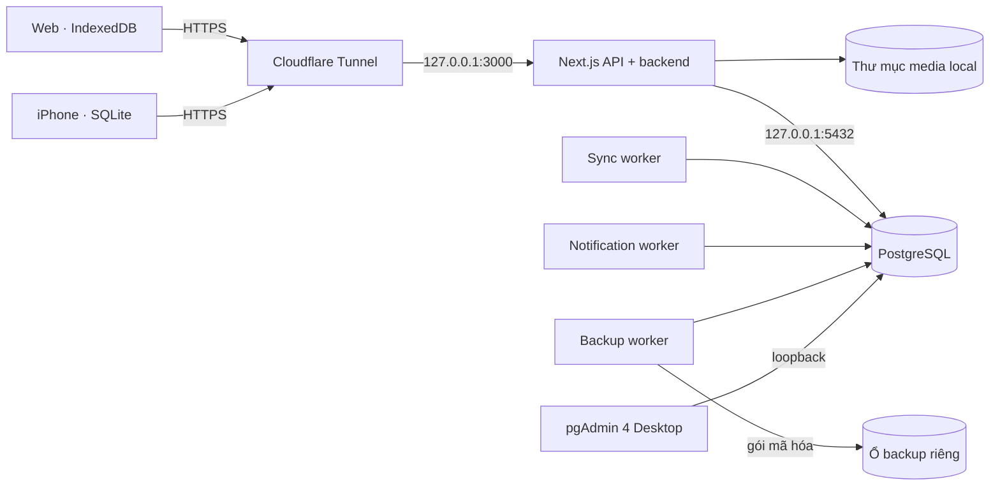

# Vận hành LumaPOS tự host

Tài liệu này mô tả runtime PostgreSQL + Next.js đã chọn, cấu hình dự kiến trên
Mac tại cửa hàng, đường chuyển lên VPS và các cổng kiểm soát trước cutover.
Đây là runbook triển khai, không phải kiểm tra trạng thái realtime. Trạng thái
đã quan sát được ghi kèm ngày kiểm tra bên dưới; trước mỗi thao tác vận hành,
xác minh lại database và runtime đang dùng.

## Kiến trúc chạy



- PostgreSQL giữ hồ sơ kinh doanh đã được chấp nhận. Next.js là API duy nhất cho
  trình duyệt và iPhone. Client không chứa thông tin đăng nhập PostgreSQL.
- Web tiếp tục lưu offline trong IndexedDB; iPhone tiếp tục lưu trong SQLite.
  Client lưu thay đổi trước khi gửi và giữ trạng thái chờ cho đến khi nhận biên
  nhận từ backend. Các command đã đưa vào sync inbox có idempotency theo
  `(store_id, event_id)` và hash payload; worker xử lý bằng khóa hàng và trả
  `accepted`, `rejected` hoặc `conflict`. Khi import relay cũ, trạng thái
  `processing` được trả về `pending`; biên nhận kết thúc được giữ nguyên.
- Backend chạy lại quy tắc nghiệp vụ trong transaction. Tồn kho, giá và tài
  chính không giải quyết bằng last-write-wins. Catalog offline là snapshot để
  tra cứu; nó không cấp quyền ghi đè giá hay tồn kho đã được server xác nhận.
- Mỗi loại command phải được chuyển và kiểm chứng riêng. Có dữ liệu offline ở
  client không đồng nghĩa mọi màn hình hiện đã hỗ trợ ghi offline.

## Mac tại cửa hàng

### PostgreSQL và pgAdmin

1. Dùng PostgreSQL 17 trên Mac, database `lumapos_local`, lắng nghe
   `127.0.0.1:5432`/localhost. Các script hiện có là
   [`scripts/setup-local-postgres-macos.sh`](../scripts/setup-local-postgres-macos.sh)
   và [`scripts/migrate-local-postgres-macos.sh`](../scripts/migrate-local-postgres-macos.sh).
2. Trong pgAdmin 4 Desktop, đăng ký server với host `127.0.0.1`, port `5432`,
   maintenance database `lumapos_local` và tài khoản quản trị DB riêng.
   pgAdmin không chạy trong Next.js và không được xuất bản qua tunnel.
3. Tách tài khoản vận hành pgAdmin khỏi role runtime của ứng dụng trước khi mở
   cho cửa hàng. Chỉ tài khoản DBA được xem/sửa bảng tùy ý hoặc chạy SQL. Người
   dùng POS quản lý tài khoản, vai trò, worker và backup trong các trang
   LumaPOS được phân quyền.
4. Các script bootstrap hiện dùng tài khoản PostgreSQL của macOS để tạo schema.
   Mô hình login role riêng cho runtime và DBA vẫn là điều kiện cần trước khi
   production; không dùng superuser làm tài khoản kết nối thường trực của Next.js.

**Trạng thái đã kiểm tra ngày 2026-11-13:** PostgreSQL 17.11 đang chấp nhận kết
nối tại `127.0.0.1:5432`. `lumapos_local` có 177 migration tới
`0165_cleanup_storage_provider.sql`, 3 cửa hàng, 3 hồ sơ, 3.292 sản phẩm, 3.157
đơn và 469 media object. Đối soát chỉ đọc với database đang cấu hình cho thấy
cùng 177 migration nhưng lệch số dòng ở 9 bảng; tổng số lượng `stock_movements`
cũng lệch 1,0 đơn vị. Snapshot này chưa được xác nhận là nguồn chính. Các số liệu là
ảnh chụp của lần kiểm tra, không khẳng định trạng thái ở thời điểm sau đó.

Trong cùng đợt, `lumapos_rehearsal` được tạo riêng, nhập từ database đang cấu
hình và đối soát thành công 140 bảng cùng các tổng hợp tài chính; 3 hồ sơ có 3
Auth credentials tương thích, không có tài khoản cần reset, receipt sync khớp.
Hai `email_verified_at` chỉ khác ở microsecond dưới độ chính xác millisecond.
Rehearsal có thêm migration local `0166_media_migration_library_assets.sql`;
`lumapos_local` và nguồn chưa áp dụng bước này.

Preview media trên rehearsal phát hiện 2.476 tham chiếu: 454 owned theo host và
bucket allowlist hiện tại, 2.022 `external_url` ngoài allowlist Supabase hiện tại;
cần rà soát domain trước cutover, không tải hoặc viết lại nhóm này. Trong 469
`media_objects` R2 có 454 `ready`, 15 `deleted`. Probe R2 hiện trả `ready: false`;
chưa chép file hay đổi provider. Vì thế rehearsal vẫn giữ R2 làm provider cho
các media hiện có và chưa bật Auth/backend mới hoặc nhận ghi từ client. Các số
liệu là ảnh chụp ngày 2026-11-13, không khẳng định trạng thái sau thời điểm đó.

### Next.js và workers

Chạy ứng dụng tự host trên loopback bằng `bun run start:self-hosted`. Dùng
LaunchDaemon với service account để tự khởi động cùng máy và phục hồi khi tiến
trình lỗi; không phụ thuộc vào cửa sổ Terminal hay phiên đăng nhập của nhân viên.
Ví dụ plist, wrapper và quy trình cài đặt nằm trong
[`ops/macos`](../ops/macos/README.md). PostgreSQL được Homebrew quản lý.

Các tiến trình dài hạn:

```bash
bun run sync:postgres:worker
bun run notifications:postgres:worker
bun run db:backup:worker -- --scheduled
```

Worker sync nhận command qua PostgreSQL inbox. Worker notification lấy việc từ
`notification_outbox`; không cần QStash. Backup worker tạo một bản mỗi ngày và
tiếp tục chờ việc backup thủ công trong hàng đợi.

Các tác vụ định kỳ gọi vào origin loopback, không đi qua Internet:

```bash
bun run ops:maintenance -- --task=notifications
bun run ops:maintenance -- --task=media-cleanup
bun run ops:maintenance -- --task=einvoices
```

Mỗi lệnh yêu cầu `CRON_SECRET`; chỉ local supervisor được gọi. Trước khi cấu
hình lịch Mac, phân biệt lịch hiện có với endpoint chưa được lịch hóa:

| Công việc | Hiện trạng theo `vercel.json` | Hành động trên Mac |
| --- | --- | --- |
| `/api/cron/notifications/outbox` | Mỗi ngày lúc 00:00 UTC (07:00 giờ Việt Nam). Worker PostgreSQL mới đã tự poll và phục hồi outbox liên tục. | Không tạo cron lặp lại cho route này sau cutover. |
| `/api/cron/media/cleanup` | Mỗi ngày lúc 02:15 UTC (09:15 giờ Việt Nam). | Giữ lịch này trong lần chuyển đầu để bảo toàn hành vi; chỉ đổi sang sau giờ đóng cửa khi chủ cửa hàng duyệt. |
| `/api/cron/notifications` | Không có trong `vercel.json`; route chạy thông báo nghiệp vụ định kỳ và bảo trì. | Chưa tự tạo lịch mới. Xác nhận lịch đang dùng và múi giờ trước khi chuyển. |
| `/api/cron/einvoices` | Không có trong `vercel.json`. | Chỉ bật sau khi chốt tần suất và hoàn tất rehearsal nghiệp vụ. |

Không để cron legacy của Vercel chạy song song sau cutover. Lịch Mac phải dùng
`launchd` và gọi `ops:maintenance` trên loopback; không mở endpoint cron ra
Internet. Giữ lịch cụ thể trong cấu hình deployment theo giờ địa phương của
cửa hàng, không suy diễn lịch mới từ tên endpoint.

Health check:

- `/api/health/live` xác nhận tiến trình Next.js.
- `/api/health/ready` kiểm tra PostgreSQL và heartbeat mới hơn 45 giây của sync,
  notification, backup worker. Khi Auth provider là `lumapos`, route trả 503
  nếu database hoặc bất kỳ worker bắt buộc nào chưa sẵn sàng; ở runtime legacy,
  chỉ yêu cầu PostgreSQL.
- Trang `/admin` hiển thị quản lý tài khoản cùng trạng thái backend, workers,
  hàng đợi sync và backup cho owner.

### File, URL và quyền truy cập

- Trên Mac, đặt `MEDIA_WRITE_PROVIDER=local` và `MEDIA_LOCAL_ROOT` ở một thư
  mục dữ liệu riêng, ví dụ `/Users/Shared/LumaPOS/media`; không đặt trong repo.
- Database chỉ lưu provider, bucket, object key, metadata và checksum ổn định;
  không lưu đường dẫn tuyệt đối của Mac. URL công khai được tạo từ
  `LUMAPOS_PUBLIC_URL` và route media của backend. Media private dùng URL ký có
  thời hạn, được backend kiểm tra quyền; không để lộ đường dẫn filesystem.
- Khi chuyển lên VPS, giữ nguyên key và schema; chuyển thư mục media sang volume
  bền vững, đổi `MEDIA_LOCAL_ROOT`/`DATABASE_URL` và giữ nguyên hostname công
  khai nếu có thể. Không dùng ổ tạm hoặc filesystem container để lưu media.
- `media:migrate` inventory cả media object đã quản lý trên R2/Supabase Storage
  lẫn tham chiếu legacy. Dùng `--local-database --target-provider=local` để chỉ
  ghi vào DB local đã chọn qua `LUMAPOS_LOCAL_DATABASE_NAME`; script từ chối chạy
  local target với `DATABASE_URL` cấu hình. Managed object giữ nguyên ID và link,
  đồng thời chép/kiểm tra cả thumbnail. Xem
  [`media-r2-migration-runbook.md`](media-r2-migration-runbook.md) để chạy một
  migration riêng cho mỗi store. Chỉ xóa nguồn sau cửa sổ giữ lại đã duyệt.
  Các media ngoài allowlist phải được rà soát; không tải hoặc xóa chúng như
  media của cửa hàng.
- Backup local media cùng database; đặt backup ở volume/thư mục tách biệt. Đồng
  bộ thêm bản backup đã mã hóa tới vị trí offsite, giữ khóa mã hóa ở nơi khác.

## iPhone ngoài mạng cửa hàng: Cloudflare Tunnel

Cloudflare Tunnel đã được chọn. Tạo tunnel đặt tên riêng cho cửa hàng và trỏ
hostname HTTPS đã duyệt tới `http://127.0.0.1:3000`. Khuyến nghị dùng
`pos.lumapos.shop` làm origin chung cho web và API để cookie web cùng endpoint
iPhone có một host ổn định. DNS/tunnel chưa được cấu hình và tên này chưa được
xác nhận. Mẫu không chứa tunnel credential ở
[`ops/cloudflared/config.yml.example`](../ops/cloudflared/config.yml.example).

- Tunnel tạo kết nối outbound; router không mở cổng inbound tới Mac. Chỉ route
  hostname ứng dụng tới Next.js. Catch-all phải trả 404.
- Không publish PostgreSQL, pgAdmin, SSH, hay thư mục media trực tiếp qua tunnel.
  Không đặt Cloudflare Access trước toàn bộ API; xác thực tài khoản LumaPOS và
  xác minh chữ ký webhook được thực hiện tại backend.
- Cấu hình `LUMAPOS_PUBLIC_URL` bằng origin HTTPS công khai này. iOS lấy API
  origin từ build setting `LUMA_API_BASE_URL` trong
  [`Info.plist`](../../luma-pos-mobile/native-ios/LumaPOSNative/Info.plist); cấu
  hình mặc định hiện tại vẫn là Vercel. Chỉ phát hành build trỏ tới hostname
  đã xác nhận sau khi backend, tunnel và khôi phục đã được diễn tập.
- Khi chuyển lên VPS, đưa tunnel connector sang VPS hoặc cập nhật origin phía
  tunnel; giữ hostname để web và iPhone không phải đổi endpoint. Nếu WAN hoặc
  tunnel mất kết nối, thiết bị giữ việc ở local và gửi lại khi có mạng. Truy cập
  LAN khi WAN hỏng là một lựa chọn HA riêng, chưa nằm trong phiên bản đầu.

## Biến môi trường và secrets

`.env.example` giữ cấu hình legacy làm mặc định để không vô tình chuyển runtime
đang phục vụ. Chỉ cấu hình các giá trị target trong môi trường self-hosted sau
khi final snapshot được xác nhận:

| Biến | Mac | Chuyển lên VPS |
| --- | --- | --- |
| `DATABASE_URL` | PostgreSQL loopback | Endpoint PostgreSQL private trên VPS |
| `LUMAPOS_AUTH_PROVIDER` | `lumapos` | Giữ nguyên |
| `LUMAPOS_PRIMARY_DATABASE_CONFIRMED` | `true` sau đối soát | Giữ nguyên |
| `LUMAPOS_SYNC_INBOX_ENABLED` | `true` sau rehearsal sync POS | Giữ nguyên |
| `LUMAPOS_SERVICE_FIELD_SYNC_ENABLED` | `true` chỉ khi slice service đã đạt gate | Giữ nguyên |
| `NOTIFICATION_QUEUE_PROVIDER` | `database` | Giữ nguyên |
| `MEDIA_WRITE_PROVIDER` | `local` | Giữ `local` hoặc chuyển adapter sau khi đã copy file |
| `MEDIA_LOCAL_ROOT` | Volume dữ liệu Mac | Volume dữ liệu VPS |
| `LUMAPOS_PUBLIC_URL` | Hostname HTTPS của tunnel | Giữ hostname nếu tunnel chuyển cùng domain |
| `LUMAPOS_INTERNAL_URL` | `http://127.0.0.1:3000` | Origin loopback của Next.js trên VPS |
| `LUMAPOS_BACKUP_ROOT` | Volume backup riêng | Volume backup riêng hoặc agent offsite |
| `LUMAPOS_BACKUP_ENCRYPTION_KEY` | Khóa 32 byte dạng hex | Giữ qua secret manager, không đặt cùng backup |

Self-hosted runtime phải đặt tường minh `MEDIA_WRITE_PROVIDER`; trên Mac dùng
`local`. Nếu bỏ trống khi Auth provider là `lumapos`, backend từ chối khởi tạo
media thay vì âm thầm ghi sang R2 theo mặc định legacy.

`DATABASE_URL`, `CRON_SECRET`, `MEDIA_LOCAL_SIGNING_SECRET`, khóa backup, khóa
mobile và credentials của webhook/provider chỉ có ở server. Không commit
`.env.local`, không đưa biến server vào `NEXT_PUBLIC_*`. Wrapper launchd trên
Mac đọc file shell assignments có owner là service account và mode `0600`; không
đặt giá trị secret trong plist hoặc log. Trên VPS dùng secret manager hoặc file
quyền `0600`.

Migrations nằm trong `drizzle/` và được apply theo thứ tự qua runner có kiểm tra
session/advisory lock. Local bootstrap dùng `bun db:migrate:local`; môi trường
đã provision dùng quy trình migration đã duyệt, không dùng `drizzle-kit push`
trực tiếp lên production. Bản restore phải dùng cùng major PostgreSQL với
backup.

## Auth và quản trị LumaPOS

- Bảng `profiles` giữ danh tính nghiệp vụ, store và role; `auth_credentials`
  chứa email chuẩn hóa, hash mật khẩu, trạng thái cần reset và giới hạn đăng
  nhập. Browser dùng cookie `HttpOnly`; iPhone dùng access/refresh token trong
  Keychain. Server lưu hash token, session scope theo tài khoản/store/thiết bị,
  rotate refresh token và hỗ trợ thu hồi session.
- Snapshot import giữ profile ID và password hash bcrypt tương thích. Profile
  không có hash hợp lệ được đánh dấu cần đặt lại mật khẩu; không import session
  Supabase. Sau chuyển Auth, web/iPhone phải đăng nhập lại. Pending client data
  được giữ để retry sau đăng nhập.
- Phân quyền UI/API dựa trên role và store của LumaPOS. Quản trị viên mời/tạo
  user, gán role, khóa tài khoản và thu hồi session trong `/admin`; màn hình này
  không cung cấp console SQL.
- pgAdmin là công cụ DBA. Không cấp tài khoản pgAdmin hoặc role có DDL cho user
  bán hàng. Mọi thao tác kinh doanh vẫn đi qua API và audit domain hiện hữu.

## Backup và restore

Backup worker dùng `pg_dump` custom format cho schema `public`, snapshot media
local, ghi checksum từng thành phần và mã hóa gói bằng AES-256-GCM. Dữ liệu lịch
sử của bảng `database_backup_runs` không nằm trong backup; schema của bảng vẫn
được giữ để runtime khởi động được sau restore. Secrets và database Supabase
system schemas không nằm trong gói. Worker tự tìm `pg_dump`/`pg_restore` ở
Homebrew PostgreSQL 17 trên Mac hoặc trong `PATH` trên VPS và từ chối chạy nếu
major version công cụ khác PostgreSQL server. Có thể đặt
`LUMAPOS_POSTGRES_BIN_DIR` khi binary nằm ở đường dẫn tùy chỉnh.

1. Mỗi ngày tạo backup vào `LUMAPOS_BACKUP_ROOT`; kiểm tra trạng thái tại
   `/admin/operations` và cảnh báo khi worker quá hạn/backup lỗi.
2. Copy gói mã hóa sang nơi offsite; đề xuất giữ 30 bản/ngày cùng bản cuối tháng.
   Không xóa bản gần nhất thành công; giới hạn lưu trữ và cảnh báo dung lượng ổ
   là việc vận hành bắt buộc trước go-live.
3. Diễn tập restore vào database mới, rỗng và thư mục media rỗng bằng
   `bun run db:restore -- --confirm-empty-database --archive lumapos-<uuid>.lumaenc`.
   Có thể truyền `--sha256 <checksum>` để đối chiếu checksum ngoài. Dừng app
   trước restore; không restore đè database đang chạy.
4. Nếu restore dừng giữa chừng, giữ app dừng, bỏ database/media staging bị lỗi,
   tạo target rỗng mới rồi chạy lại. Kiểm tra row/financial aggregates, file
   checksum và `/api/health/ready` trước khi mở traffic.

Worker backup cần `LUMAPOS_PRIMARY_DATABASE_CONFIRMED=true`, Auth provider
`lumapos`, media provider local, `pg_dump`, tar và khóa backup. Đây là điều kiện
để worker không tạo snapshot nhầm từ Supabase hoặc bỏ sót media chưa local.

## Data rehearsal, cutover và rollback

Không chạy dual-write. Trước cutover, source vẫn là runtime legacy; target local
chỉ nhận bản rehearsal và chưa được mở cho người dùng.

### Diễn tập trước ngày cutover

1. Xác nhận hostname HTTPS ổn định, tunnel chạy khi Mac khởi động, app và worker
   có supervisor, PostgreSQL chỉ bind loopback, pgAdmin không public.
2. Dùng database rehearsal riêng, ví dụ `lumapos_rehearsal`, bằng cách đặt
   `LUMAPOS_LOCAL_DATABASE_NAME` cho cả `db:migrate:local`, `db:import:local` và
   `db:reconcile:local`. Importer chỉ nhận target bootstrap trống; không chạy
   lên `lumapos_local` hiện đang có dữ liệu. Target được phép có các migration
   tương thích mới hơn source. Khởi chạy Auth LumaPOS và workers trong môi trường
   riêng. Chưa đặt `LUMAPOS_PRIMARY_DATABASE_CONFIRMED=true` cho production.
3. Copy media ban đầu tới local bằng `media:migrate`; kiểm tra checksum và mọi
   tham chiếu. Không xóa nguồn Supabase.
4. Chạy importer với `--confirm-bootstrap-target`, rồi đối soát cùng database
   rehearsal. Cờ xác nhận bắt buộc vì importer thay bootstrap rows sau khi dump
   nguồn thành công. Xử lý mọi khác biệt về table counts, orders, payments,
   purchase orders, stock, Auth và sync receipt trước khi lên lịch cutover. Không
   chạy importer lên database đang có business data.
5. Test login/password reset, thu hồi session, web/mobile API, sync lặp cùng event
   ID, conflict tồn kho/giá/tài chính, file public/private, payment webhooks,
   e-invoice và notification trên target.

### Cutover một lần

1. Chuẩn bị build iPhone có `LUMA_API_BASE_URL` trỏ hostname cuối cùng; chuẩn bị
   web release Next.js self-hosted. Chưa chuyển DNS/route khi rehearsal chưa đạt.
2. Thông báo cửa sổ bảo trì; đặt `LUMAPOS_MAINTENANCE_MODE=true` trên legacy
   web, dừng Vercel Cron và mọi worker/seed/import đang ghi. Đợi request và
   payment webhook đang chạy kết thúc hoặc được nhà cung cấp retry.
3. Copy delta media cuối cùng, verify; tạo một database cutover mới, rỗng, apply
   migrations và nhập final snapshot PostgreSQL/Auth/relay vào database đó.
   Reconcile counts, financial aggregates, Auth reset count, sync receipts,
   media references và checksums. Giữ nguyên các database snapshot cũ để rollback
   và điều tra; không ghi đè database đã có dữ liệu.
4. Tạo encrypted backup của target. Đặt target env sang
   `LUMAPOS_AUTH_PROVIDER=lumapos`, `NOTIFICATION_QUEUE_PROVIDER=database`,
   `MEDIA_WRITE_PROVIDER=local` và `LUMAPOS_PRIMARY_DATABASE_CONFIRMED=true`.
   Bật `LUMAPOS_SYNC_INBOX_ENABLED=true` cho POS sync; chỉ bật
   `LUMAPOS_SERVICE_FIELD_SYNC_ENABLED=true` nếu slice service đã vượt
   rehearsal. Khởi động backend/workers, xác nhận `/api/health/ready`, login,
   upload/download private file, sync và webhook.
5. Chuyển hostname Cloudflare Tunnel tới Next.js Mac, mở traffic, kiểm tra phiên
   browser và iPhone, theo dõi pending queue, rejected/conflict, health, disk,
   worker và backup. Không bật lại Vercel Cron hoặc ghi business vào Supabase.
6. Giữ Supabase Cloud và media nguồn read-only trong rollback window đã duyệt.
   Xóa chúng chỉ sau khi hết cửa sổ, không còn request đọc legacy, media đã đủ
   checksum, backup restore đã diễn tập và chủ sản phẩm ký xác nhận.

### Rollback

- Trước khi backend mới nhận ghi, có thể giữ maintenance mode và trả hostname về
  runtime cũ.
- Sau khi PostgreSQL mới đã nhận ghi, không trỏ ngược sang Supabase snapshot cũ:
  điều đó làm mất các giao dịch mới và tạo hai lịch sử. Ưu tiên khôi phục app
  version trên cùng PostgreSQL; khi hỏng host/database, restore backup vào
  staging và chuyển traffic sau đối soát.
- Rollback dữ liệu về Supabase sau khi đã ghi trên PostgreSQL cần một reverse
  import riêng được diễn tập và ký duyệt; công cụ hiện tại chưa cung cấp reverse
  cutover an toàn. Giữ nguồn Supabase trong thời gian bảo lưu không đồng nghĩa
  được dual-write.

## Chuyển cùng runtime lên VPS

1. Provision cùng major PostgreSQL và apply cùng thư mục migration `drizzle/`.
2. Dừng ghi trên Mac, tạo encrypted backup, restore vào database/media volume
   rỗng của VPS, reconcile counts và checksums.
3. Chuyển `.env` server-side: database private endpoint, media volume, backup
   volume, secrets manager và process supervisor (systemd). Giữ Auth provider,
   queue provider, schema, object keys, API contract và hostname.
4. Chuyển Cloudflare Tunnel connector sang VPS, kiểm tra `/api/health/ready`,
   mở traffic rồi giữ Mac ở chế độ không ghi cho đến hết khoảng xác minh.
5. Không mở PostgreSQL public; pgAdmin từ máy quản trị truy cập bằng SSH
   port-forward hoặc VPN, không qua Cloudflare Tunnel.

## Các quyết định trước go-live

- Chốt hostname API và quyền quản lý DNS/tunnel; `pos.example.com` trong mẫu
  chỉ là placeholder.
- Chốt account recovery/password reset và recovery administrator. Hash không
  chuyển được phải có quy trình reset hỗ trợ, không gửi mật khẩu tạm qua log.
- Chốt role PostgreSQL runtime/DBA và cách giữ secrets trên Mac.
- Chốt rollback window, retention offsite, RPO/RTO và thời gian phục hồi được
  chấp nhận.
- Chốt có cần route LAN riêng cho iPhone khi WAN cửa hàng mất hay chấp nhận giữ
  command offline cho đến khi Internet trở lại.
- Chốt các command nghiệp vụ nào được phép offline ở đợt đầu; mọi command khác
  phải tiếp tục hiển thị rõ là cần online.
